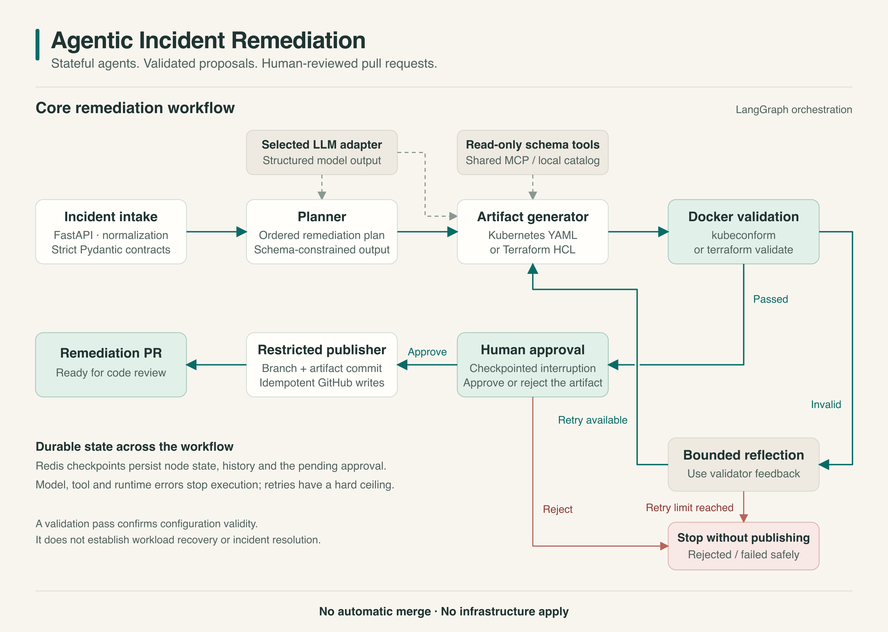
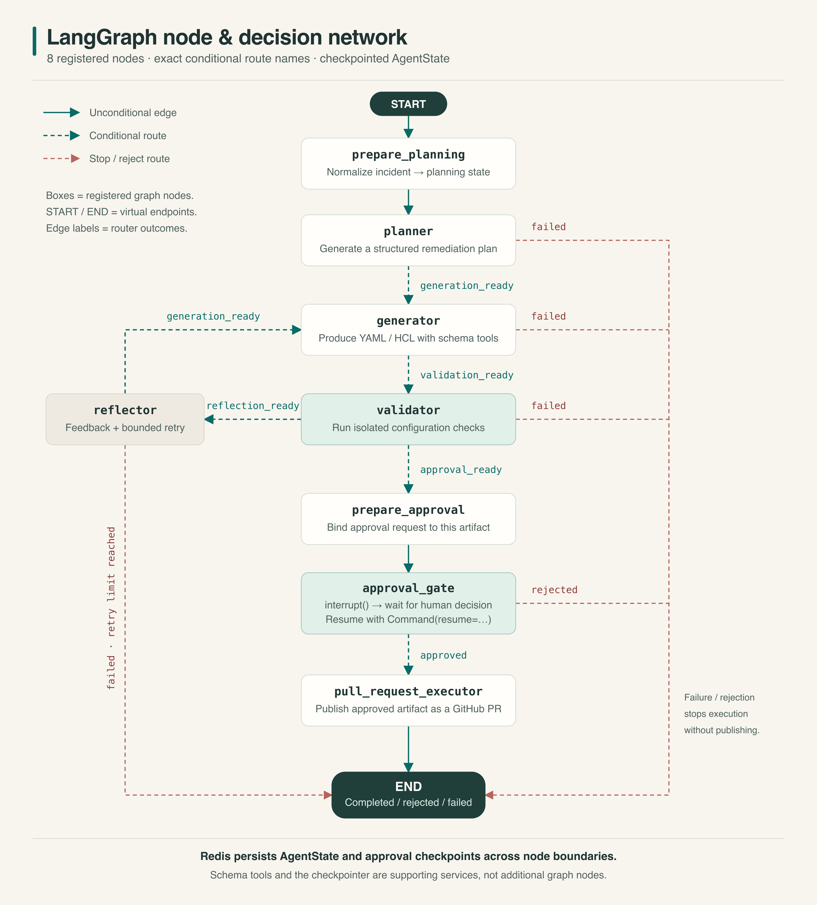

# Agentic Incident Remediation

A multi-agent system that turns infrastructure incident alerts into validated,
human-reviewed remediation pull requests.

LangGraph coordinates planning, configuration generation, isolated validation, bounded
correction, and human approval. The system produces Kubernetes YAML or Terraform HCL
without applying changes to infrastructure.

## Core workflow



1. Normalize an incident into a typed workflow state.
2. Create a remediation plan and generate an artifact using read-only schema tools.
3. Validate the configuration in an isolated Docker container.
4. Use validator feedback to regenerate invalid artifacts, within a fixed retry limit.
5. Pause for human review before publishing an approved artifact as a GitHub pull request.

### LangGraph node network



The graph has eight registered nodes with explicit success, reflection, rejection, and
failure routes. Redis checkpoints preserve execution state and the pending approval.
Reflection processes validator feedback; the generator makes the model call for a correction.

## Key capabilities

- **Typed orchestration:** Pydantic contracts, explicit state transitions, and bounded retries.
- **Schema-grounded generation:** read-only Kubernetes and Terraform tools exposed through MCP.
- **Isolated validation:** `kubeconform` and `terraform validate` in resource-limited containers.
- **Human approval:** checkpointed review tied to the exact generated artifact.
- **Restricted publication:** branch creation, one artifact commit, and a pull request.
- **Review dashboard:** incident queue, workflow progress, full-file change highlights,
  validation counts, review verdicts, and artifact downloads.

## Technology stack

| Area | Technologies |
| --- | --- |
| API and contracts | Python 3.12+, FastAPI, Pydantic, HTTPX |
| Agent orchestration | LangGraph, Redis checkpoints, MCP |
| Model integrations | Gemini, Hugging Face; experimental local Ollama mode |
| Validation | Docker, kubeconform, Terraform |
| Dashboard | HTML, CSS, JavaScript, SQLite run history |
| Testing and automation | pytest, Ruff, mypy, GitHub Actions |
| Observability | Structured JSON logs, Prometheus metrics |

## Getting started

Create a Python environment and install the project:

```bash
python3.12 -m venv .venv
source .venv/bin/activate
python -m pip install -e '.[dev]'
```

### Offline mode

```bash
agentic-remediation-check --mode offline
agentic-remediation-demo
```

Open <http://127.0.0.1:8000>. This mode uses deterministic model, validation, and
publication adapters. It requires no credentials, Docker, or Redis and makes no
external service calls.

### Actions-backed dashboard

```bash
agentic-remediation-actions
```

Open <http://127.0.0.1:8001>. The dashboard starts the configured GitHub workflow,
retrieves verified proposal evidence, and tracks review and publication. Docker validation
and Redis run on GitHub, not on the laptop.

A server-side GitHub credential, the repository workflow, a model secret, and a
required-reviewer environment must be configured. Final approval takes place in GitHub.
For opt-in local generation, start with `--experimental-ollama`; validation and review
still use GitHub. See the [dashboard guide](docs/actions-dashboard.md) for configuration.

### Tests

```bash
pytest
ruff check .
ruff format --check .
mypy
```

The default test suite uses deterministic adapters and mocked HTTP. Real Docker and Redis
checks are opt-in; see [integration testing](docs/integration.md).

## Safety and validation limits

Generated files are proposals restricted to `remediations/`. Publication requires validation
and human approval; the publisher cannot merge a PR or deploy infrastructure.

Configuration validation checks schema and configuration validity. It does **not** prove that
a change resolves an incident or restores a workload. The simulator uses predefined scenarios,
not continuous monitoring of a live cluster. Provider selection is explicit; there is no
automatic model-provider fallback.

Keep credentials out of source control. The Actions dashboard is a loopback-only,
single-user interface, not a public authenticated service.

## Documentation

- [Architecture and trust boundaries](docs/architecture.md)
- [Dashboard configuration and operations](docs/actions-dashboard.md)
- [Container integration tests](docs/integration.md)
- [Validator images and sandbox configuration](sandbox/README.md)
