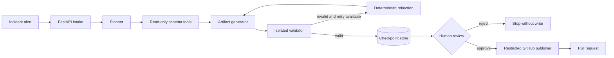

# Architecture

The engine treats every generated change as an untrusted proposal. It separates reasoning,
validation, human authorization, and repository operations so no model or graph node can directly
modify Kubernetes or cloud infrastructure.

## Component boundaries

| Component | Responsibility | Explicitly cannot do |
| --- | --- | --- |
| API and dashboard | Accept incidents, expose state, collect approval | Bypass workflow validation |
| Planner | Produce a typed, ordered remediation plan | Execute infrastructure commands |
| Schema tools | Return curated read-only resource contracts | Read a live cluster or cloud account |
| Generator | Produce one repository-confined YAML or HCL artifact | Write outside `remediations/` |
| Sandbox | Run one allowlisted validator with bounded resources | Access network, credentials, or host mounts |
| Approval gate | Persist and correlate one human decision | Treat a model response as authorization |
| Publisher | Create a branch, commit one artifact, open/recover a PR | Merge, deploy, run shell, or apply infrastructure |

## Runtime modes

The offline demo uses an in-memory checkpointer and deterministic adapters. It exercises the real
API, typed state, graph routing, approval interrupt, and publisher capability boundary without
network calls or credentials.

Live mode swaps in Hugging Face inference, Redis checkpoints, locked-down Docker validation, and
the GitHub API. It requires both `HF_TOKEN` and `GITHUB_TOKEN`; approving a live execution may
create a branch and pull request in the configured repository. It still has no apply or merge
capability.

## Failure behavior

- Invalid model output is rejected by strict Pydantic schemas.
- Unsafe paths and apply/destroy command text are rejected before validation.
- Validation failures enter a bounded correction loop; exhausted retries fail closed.
- Sandbox startup errors terminate the workflow instead of silently passing validation.
- Approval IDs are correlated to the current persisted interrupt, preventing stale decisions.
- Conflicting content on an existing remediation branch stops publication.

Prometheus counters expose request totals, workflow starts, human decisions, and terminal outcomes.
JSON logs include request IDs but never request bodies or credentials.

Redis checkpoint serialization uses an explicit list of the engine's validated domain contracts
for JSON and MessagePack recovery. Pickle fallback and wildcard application-class reconstruction
remain disabled. Redis access is still a trusted boundary; never expose the checkpoint database to
untrusted clients. The container integration suite exercises recovery in a separate Python process,
including the native approval interrupt and checkpointed execution controls.
